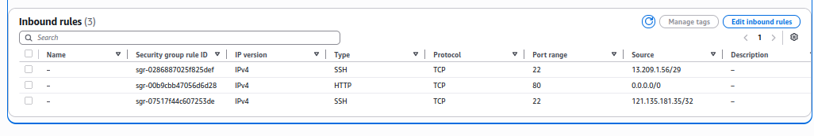
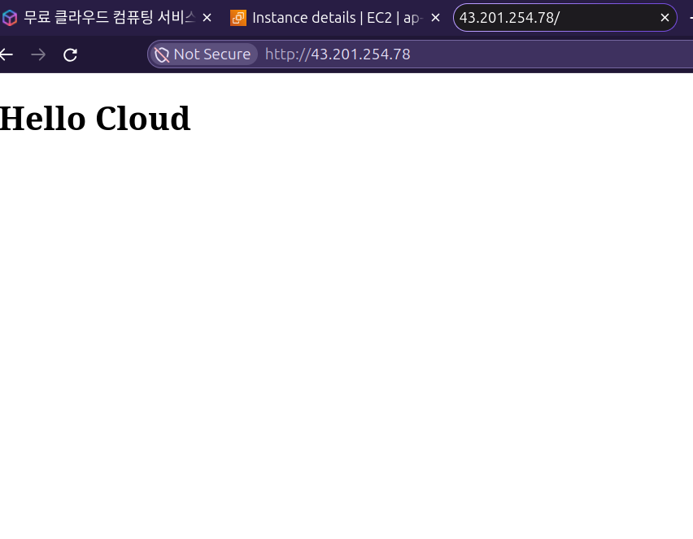
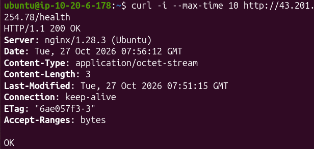
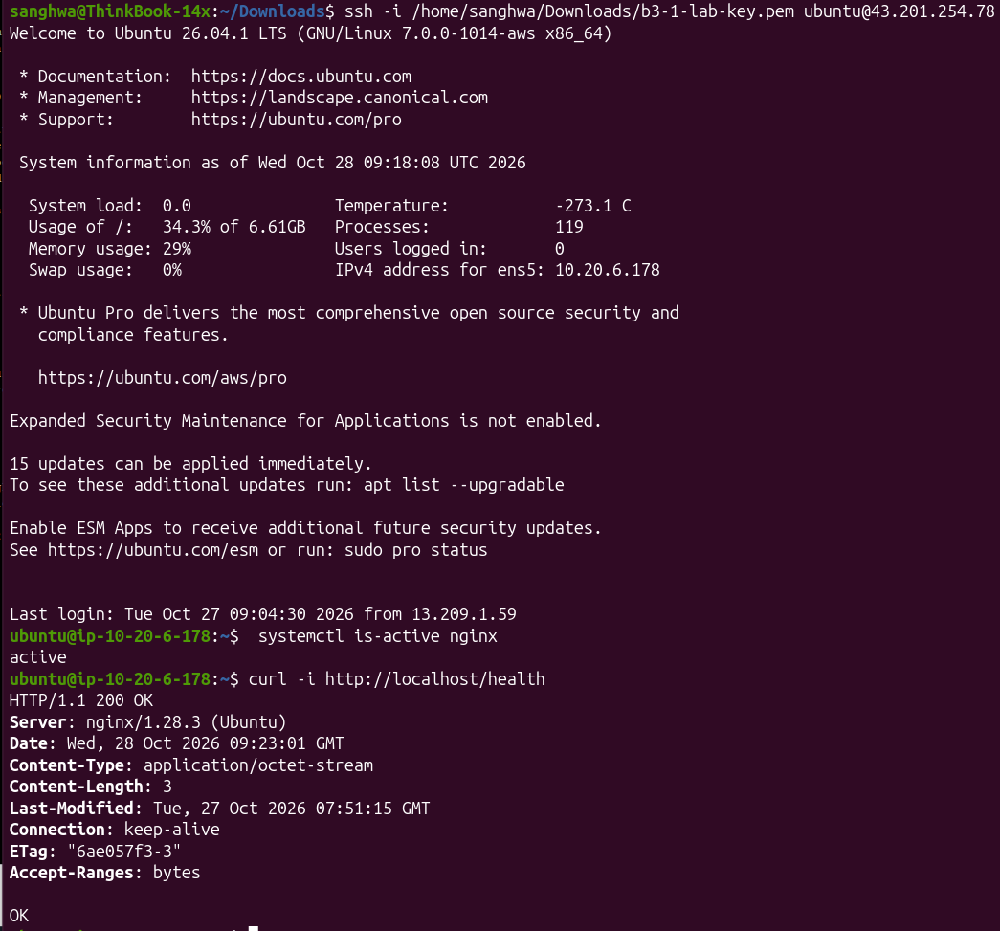
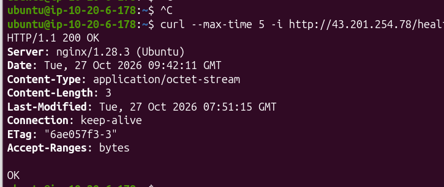

# AWS VPC 웹 서비스 실습 (B3-1)

> **미션**: "일단 서버에 올렸는데 외부에서 안 들어와요." — VPC로 격리된 네트워크를 직접 설계하고, 최소권한 원칙까지 적용한 서비스 환경을 완성합니다.

---

## 1. 개요

| 항목 | 내용 |
|------|------|
| **리전** | ap-northeast-2 (Seoul) |
| **IAM Principal** | 실습용 IAM 사용자 (EC2/VPC/SG 최소권한) |
| **검증 방식** | **GET `http://<PUBLIC_IP>/health`** |
| **검증 URL** | `http://43.201.xxx.xxx/health` |
| **검증 결과** | `HTTP 200 OK` + 응답 본문 `OK` |
| **스크린샷** | `./screenshots/terminal.png` |

> ⚠️ **참고**: 실습 종료 후 인스턴스를 종료하므로 검증 URL은 더 이상 응답하지 않습니다. 검증 당시 결과와 리소스 종료일을 함께 기록합니다.

---

## 2. 아키텍처 구성

### 2.1 네트워크 리소스

| 리소스 | ID / 값 | 비고 |
|--------|---------|------|
| **VPC** | `vpc-03a01xxxxxxxxxxxx` | CIDR: `10.20.0.0/16` |
| **Public Subnet** | `subnet-03a1aexxxxxxxxxxx` | CIDR: `10.20.1.0/24`, AZ: `ap-northeast-2a` |
| **Internet Gateway** | `igw-0ad0e6xxxxxxxxxx` | VPC에 Attached |
| **Route Table** | `rtb-048fc9xxxxxxxxxx` | `0.0.0.0/0 → IGW` 경로 보유 |

### 2.2 컴퓨트 및 보안

| 리소스 | ID / 값 | 비고 |
|--------|---------|------|
| **EC2 Instance** | `i-0babbe8xxxxxxxxxx` | `aws-lab-web`, Ubuntu 24.04 LTS, t3.micro |
| **Public IP** | `43.201.xxx.xxx` | Auto-assign Public IP 활성화 |
| **Security Group** | `sg-0c7971xxxxxxxxxx` | `aws-lab-web-sg` |
| **Key Pair** | `b3-1-lab-key` | `.pem` 파일 로컬 보관 |

### 2.3 보안 그룹 인바운드 규칙

| 프로토콜 | 포트 | 소스 | 용도 |
|----------|------|------|------|
| TCP | 80 (HTTP) | `0.0.0.0/0` | 웹 서비스 전체 공개 |
| TCP | 22 (SSH) | **MY IP** (`xxx.xxx.xxx.xxx/32`) | 관리자 접속만 허용 |

> **원칙**: 0.0.0.0/0에 대해 전체 포트(0-65535) 허용 규칙 없음, SSH는 개인 IP만 허용

#### 보안 그룹 인바운드 규칙 화면



---

## 3. 아키텍처 다이어그램


다이어그램에는 다음이 표현되어 있습니다:

- VPC(`10.20.0.0/16`)와 Public Subnet(`10.20.1.0/24`)
- Internet Gateway 연결 및 Route Table 기본 경로(`0.0.0.0/0 → IGW`)
- EC2 인스턴스(Ubuntu + Nginx)와 Public IP
- Security Group 인바운드 규칙(HTTP 80 전체 공개, SSH 22 내 IP만)
- 외부 클라이언트 → EC2 웹 서버로 들어오는 트래픽 흐름

---

## 4. 외부 접속 검증

### 4.1 검증 명령

```bash
curl -i --max-time 10 http://43.201.xxx.xxx/health
```

### 4.2 검증 결과

```
HTTP/1.1 200 OK
Server: nginx/1.28.3 (Ubuntu)
Content-Type: application/octet-stream
Content-Length: 3

OK
```

### 4.3 검증 스크린샷

#### 외부에서 접속 (브라우저)



#### 외부에서 접속 (터미널 curl)



#### EC2 내부에서 접속 (SSH 후 로컬 헬스체크)

> SSH로 EC2 접속 후 `curl http://localhost/health` 실행 — **애플리케이션 계층 정상 확인**



---

## 5. 트러블슈팅 보고서

상세 내용은 [`troubleshooting.md`](./troubleshooting.md) 참조

**요약**: Security Group 인바운드에서 HTTP 80 규칙을 일시 제거 → 외부 접속 타임아웃 재현 → 내부 localhost는 정상 → 규칙 복구 후 외부 접속 성공 확인. 원인: SG 인바운드 HTTP 80 규칙 누락. 재발 방지를 위한 백업/검증/문서화 절차 수립.

#### 수정 후 검증 결과



---

## 6. 리소스 정리 체크리스트

상세 내용은 [`cleanup-checklist.md`](./cleanup-checklist.md) 참조

| 순서 | 리소스 | 정리 상태 | 비고 |
|------|--------|-----------|------|
| 1 | EC2 Instance | **Terminated** | Stop이 아닌 Terminate |
| 2 | EBS Volumes | **Deleted** | 미사용 볼륨 포함 확인 |
| 3 | Elastic IP | **Released** | 할당하지 않음 (확인만) |
| 4 | Network Interfaces | **Deleted** | 잔여 ENI 정리 |
| 5 | Security Group | **Deleted** | `aws-lab-web-sg` |
| 6 | Route Table | **Deleted** | Subnet 연결 해제 후 삭제 |
| 7 | Internet Gateway | **Detached & Deleted** | VPC에서 Detach 후 삭제 |
| 8 | Subnet | **Deleted** | `subnet-03a1aexxxxxxxxxxx` |
| 9 | VPC | **Deleted** | `vpc-03a01xxxxxxxxxxxx` |
| 10 | NAT Gateway / ELB / RDS | **미생성** | 생성하지 않음 |

> **확인일**: 2026-10-27  
> **확인 리전**: ap-northeast-2  
> **Billing 확인**: 사용량 및 요금 항목 확인 완료 (청구 데이터 반영 지연 고려)

---

## 7. 프로젝트 구조

```
.
├── README.md
├── architecture.png
├── troubleshooting.md
├── cleanup-checklist.md
└── screenshots/
    ├── architecture.png
    ├── browser.png
    ├── terminal.png
    ├── ssh-health-check.png
    ├── sg-inbound-rules.png
    ├── health-check-in-ec2.png
    ├── fixed.png
    └── troubleshooting.png
```

---

## 8. 회고 / 학습 내용

### 8.1 네트워크 흐름 이해

> 외부 요청 → Internet Gateway → Route Table(`0.0.0.0/0 → IGW`) → Public Subnet → Security Group(HTTP 80 허용) → EC2:Nginx → 응답 역방향

### 8.2 보안 그룹 vs IAM

- **Security Group**: 네트워크 패킷 레벨 제어 (인바운드/아웃바운드 트래픽 필터링)
- **IAM**: AWS API 호출 권한 제어 (리소스 생성/조회/수정/삭제 권한)
- 두 가지는 **서로 다른 레이어**에서 동작하며, 둘 다 최소권한 원칙 적용 필요

### 8.3 트러블슈팅 프로세스

1. **증상 확인**: 외부 타임아웃, 내부 정상
2. **가설 수립**: SG 규칙 누락 의심
3. **검증**: SG/RT/퍼블릭 IP/내부 curl/로그 확인
4. **조치**: SG HTTP 80 규칙 추가
5. **결과**: 외부 200 OK 확인
6. **재발 방지**: 백업/즉시 검증/Description 명시/체크리스트화

### 8.4 비용 관리

- 퍼블릭 IPv4는 시간당 과금 가능 → 불필요한 EIP 할당하지 않음
- `Delete on termination` 활성화로 EBS 자동 정리
- 실습 종료 즉시 Terminate → 볼륨/ENI/EIP/IGW/VPC 순서 정리
- Billing Dashboard에서 청구 지연 고려해 사후 확인 필수

---

## 9. 참고 자료

- [AWS Free Tier for Amazon EC2](https://docs.aws.amazon.com/AWSEC2/latest/UserGuide/ec2-free-tier-usage.html)
- [Amazon VPC 요금](https://aws.amazon.com/vpc/pricing/)
- [Internet Gateway를 사용한 인터넷 연결](https://docs.aws.amazon.com/vpc/latest/userguide/VPC_Internet_Gateway.html)
- [EC2 Security Group 생성 및 규칙](https://docs.aws.amazon.com/AWSEC2/latest/UserGuide/creating-security-group.html)
- [EC2 인스턴스 종료 동작과 EBS 볼륨](https://docs.aws.amazon.com/AWSEC2/latest/UserGuide/how-ec2-instance-termination-works.html)

---

**작성일**: 2026-10-28  
**작성자**: sanghwa-na  
**미션**: B3-1 · 내가 만든 웹사이트를 인터넷에 올려 누구나 쓰게 하기