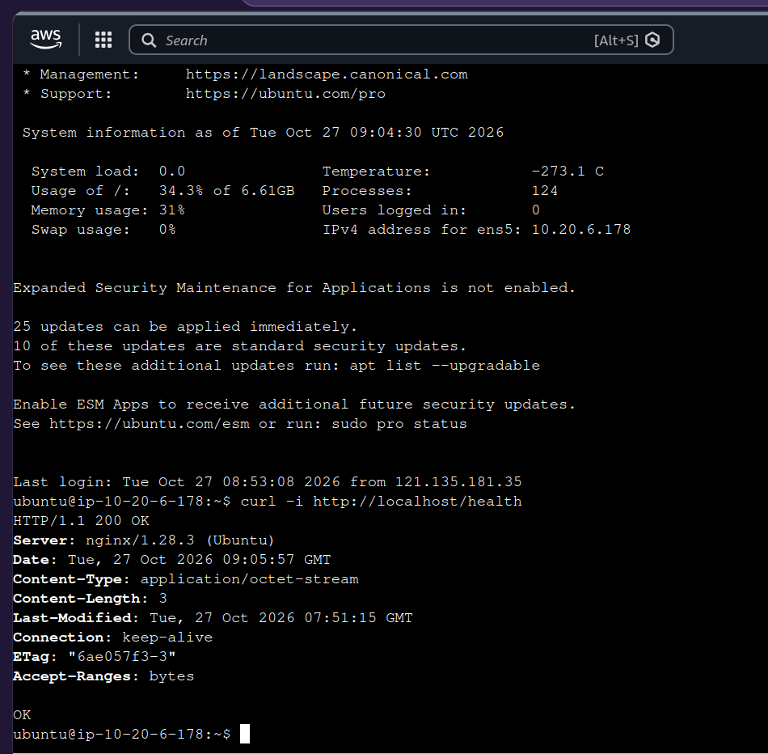

# 트러블슈팅 기록

- **날짜/시간**: 2026-10-27T19:26:10+09:00
- **리전**: ap-northeast-2
- **리소스 ID**:
  - VPC: `vpc-03a01xxxxxxxxxxxx`
  - Subnet: `subnet-03a1aexxxxxxxxxxx`
  - Security Group: `sg-0c7971xxxxxxxxxx` (`aws-lab-web-sg`)
  - EC2: `i-0babbe8xxxxxxxxxx`
  - Public IP: `43.201.xxx.xxx`

---

## 1. 증상

외부에서 관찰한 오류와 명령:

- `curl --max-time 5 -i http://43.201.xxx.xxx/health`
- `curl: (28) Connection timed out after 5002 milliseconds`

---

## 2. 원인 가설

EC2 내부에서 `curl -i http://localhost/health` 실행 성공



Security Group `aws-lab-web-sg`의 인바운드 규칙에서 **TCP 80 (HTTP) 허용 규칙이 제거**되어, 외부에서 들어오는 HTTP 트래픽이 Security Group 단계에서 차단된 것으로 추정.

**근거**:
- 내부(`localhost`) curl 성공 → Nginx 프로세스 정상, 애플리케이션 계층 문제 아님
- 외부 curl **Connection timed out** → 패킷이 인스턴스까지 도달하지 못함 (SYN 차단)
- Route Table(`0.0.0.0/0 → IGW`), 퍼블릭 IP, IGW 연결 모두 정상
- 따라서 **네트워크 경로가 아닌 Security Group 인바운드 규칙 누락**이 원인

---

## 3. 검증 및 조치

Security Group, Route Table, 퍼블릭 IP, 내부 curl, 로그 등 확인한 근거:

- **Route Table `0.0.0.0/0 → IGW` 경로 정상 확인**
- **퍼블릭 IP `43.201.xxx.xxx` 할당 정상 확인**
- **내부 `curl -i http://localhost/health` → 200 OK 확인** (Nginx 정상)
- **Security Group `aws-lab-web-sg` 인바운드에 TCP 80 규칙 없음 확인** → **규칙 추가**
- `curl --max-time 5 -i http://43.201.xxx.xxx/health` 실행 성공


---

## 4. 결과

외부 요청의 최종 HTTP 상태와 응답:

```
HTTP/1.1 200 OK
Server: nginx/1.28.3 (Ubuntu)
Date: Tue, 27 Oct 2026 11:01:58 GMT
Content-Type: application/octet-stream
Content-Length: 3
Last-Modified: Tue, 27 Oct 2026 07:51:15 GMT
Connection: keep-alive
ETag: "6ae057f3-3"
Accept-Ranges: bytes

OK
```

---

## 5. 재발 방지

- SG 변경 전 백업(JSON/스크린샷) 필수화
- 필수 포트(80, 22)는 Description에 "삭제 금지" 명시
- 변경 후 `curl /health` 즉시 검증 습관화
- 중장기적으로 IaC(Terraform)로 SG 코드 관리 전환